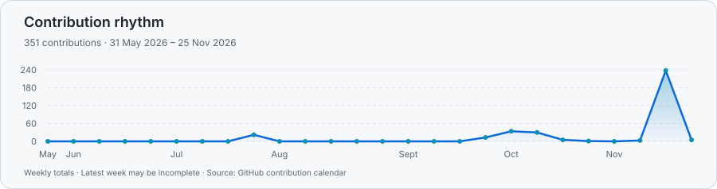

<div align="center">


# Hey, I'm Owen 👋

[](https://github.com/OwenC05)

**AI Engineer at LexisNexis Risk Solutions**<br />
Final-year **Computer Science & AI** student at the **University of Bath**

[](https://www.linkedin.com/in/owen-cheung-472998225/)
[](#-selected-work)
[](#-lets-connect)

*Finding interesting ideas. Figuring out how they work. Building them into something useful.*

</div>

---

## 🎯 What I'm working on

At LNRS, I work on agentic workflows for fraud-model optimisation: **recoverable execution, persistent state, audit trails, and human review**. My data science placement involved Python, SQL, and Snowflake.

Outside work, I'm exploring how to connect model evaluation, developer tooling, and useful software people can actually interact with.

```text
🧠 Focus       Applied AI & agentic workflows
🛠️ Building    TypeForge & Application Copilot
🔎 Exploring   Model evaluation & recoverable systems
☕ Offline     Coffee, snowboarding & mechanical keyboards
```

## 🛠️ Tools I build with

<div align="center">


</div>

---

## 🚀 Selected work

*These are independent personal projects. My employer work is internal.*

### ⌨️ [TypeForge](https://github.com/OwenC05/TypeForge)

A local-first typing app connecting browser-based practice with a Python timing-model benchmark. Native input, local history, and versioned model artifacts bring the experiment into the product.

**TypeScript · Python · Browser inference · Model evaluation**<br />
[Explore the code →](https://github.com/OwenC05/TypeForge) · [ML experiment →](https://github.com/OwenC05/TypeForge/tree/main/ml)

### 🧭 [Application Copilot](https://github.com/OwenC05/applications)

A local-first application workspace with a Python/FastAPI evidence workbench: hybrid retrieval, source inspection, durable workers, and reviewable AI drafting. An evolving project, with full-workflow and semantic-quality qualification still in progress.

**Python · FastAPI · Retrieval · Durable workflows**<br />
[Explore the code →](https://github.com/OwenC05/applications)

### 🌐 [Portfolio](https://github.com/OwenC05/Portfolio)

The source for my personal website: a home for my projects, background, and engineering interests.

**Next.js · TypeScript · Tailwind CSS**<br />
[Explore the code →](https://github.com/OwenC05/Portfolio)

---

## 📈 Building, one contribution at a time

<picture>
  <source media="(prefers-color-scheme: dark)" srcset="./assets/activity-dark.svg" />
  <source media="(prefers-color-scheme: light)" srcset="./assets/activity-light.svg" />
  
</picture>

## 🐍 Feeding the contribution snake

<picture>
  <source media="(prefers-color-scheme: dark)" srcset="./assets/snake-dark.svg" />
  <source media="(prefers-color-scheme: light)" srcset="./assets/snake-light.svg" />
  
</picture>

---

## 📫 Let's connect

Happy to talk about **applied AI, data science, software engineering**, or what you're building next.

<div align="center">

[](https://www.linkedin.com/in/owen-cheung-472998225/)
[](https://github.com/OwenC05)

*The research-to-implementation part is my favourite.*


</div>

<!-- Visual inspiration: https://github.com/Yeachan-Heo -->
